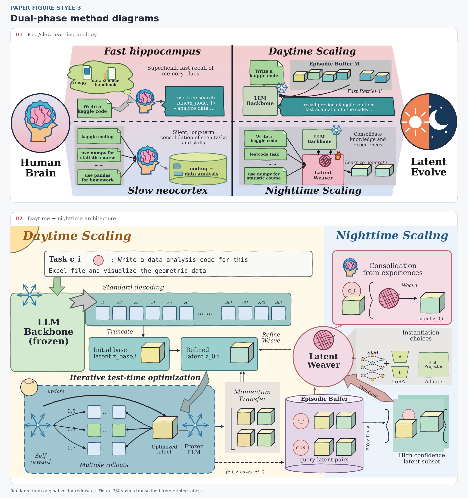
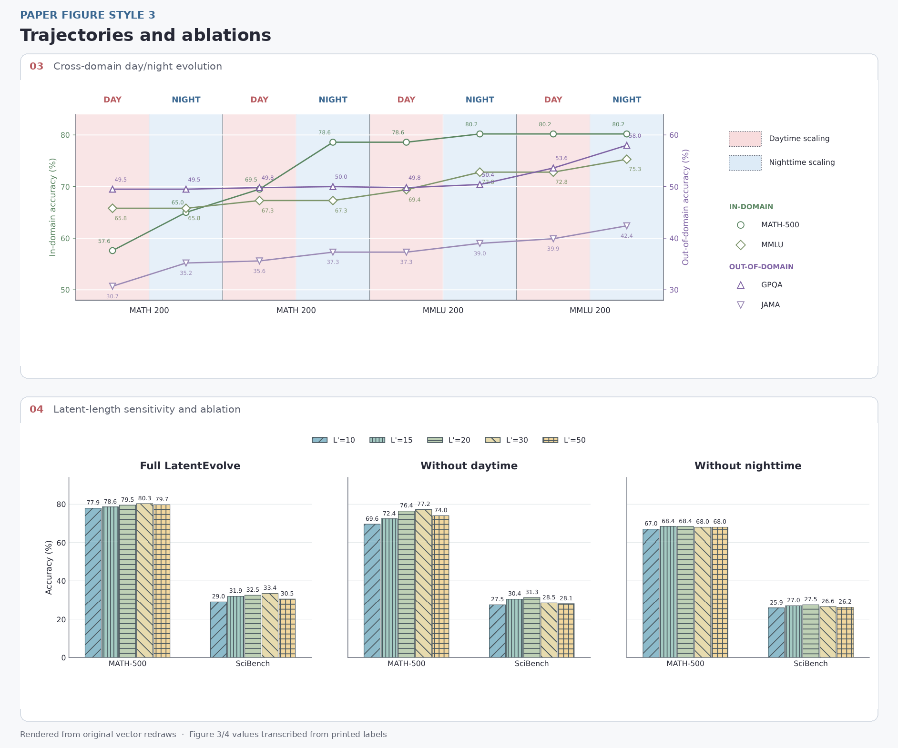

# 论文绘图风格 3

以 [*LatentEvolve: Self-Evolving Test-Time Scaling in Latent Space*（arXiv:2509.24771v1）](https://arxiv.org/abs/2509.24771v1) 中四张图为示例。**核心产物是可复用的 Python 手绘路径代码、组件布局和验收经验**：用它画别的论文图时，更换任务内容、节点和数据，保留真实文字与矢量路径。`render_examples.py` 生成四张独立绘制的 PDF；渲染过程不读取原论文图片，也不嵌入截图。

- **方法图**：`handdrawn.py` 用固定的低幅度曲线扰动绘制卡片、箭头、圆角、贝塞尔轮廓、立方体与矢量渐变；`style3.py` 组合文档、齿轮脑、昼夜徽章、冻结标记、缓冲筒等图元。`figure1_layout.py` 和 `figure2_layout.py` 把两张复杂示例拆成可修改的区域函数和标签字典。原图尺寸坐标系便于逐项对齐；文字基线不抖动。
- **统计图**：八个交替昼夜阶段的双轴四曲线，以及完整方法/去昼间/去夜间的三面板五组长度消融。
- **数值边界**：Figure 3/4 示例数值从论文图片上的标签人工转录，属于图面读数，不是原始观测数据或独立复现实验；用于新论文时必须替换成用户的数据。
- **源图与重绘差异**：保留语义拓扑、布局与色彩语法，统一为可读的矢量形状；Figure 4 的柱从零开始，和原图约 20% 起始的视觉刻度不同。

## 效果预览

以下 PNG 由独立矢量 PDF 渲染，源论文截图没有混入公开预览。

[](assets/previews/01_dual_phase_diagrams.png)

[](assets/previews/02_statistical_figures.png)

## 快速运行

在本 skill 目录中运行；已有满足依赖的 Python 环境可直接执行后三条：

```bash
python3 -m venv .venv
.venv/bin/python -m pip install -r scripts/requirements.txt
.venv/bin/python scripts/render_examples.py --book
.venv/bin/python scripts/verify_pdf.py --previews
.venv/bin/python scripts/build_previews.py
```

- Python 3.10+；依赖 Matplotlib、PyMuPDF、Pillow、NumPy，无需原 PDF、账户或联网画图服务。图 1/2 默认 DejaVu Serif；可选的 Kalam 字体及 OFL 许可放在 `assets/fonts/`。
- `outputs/` 生成 4 个单页 PDF、4 页 `examples.pdf`、逐页 PNG 与 `validation.json`；这类本地运行结果被忽略。`assets/previews/` 两张精选图集随 skill 分发。
- 只画单个例子：`python3 scripts/render_examples.py --figures 3`。参数 `--output-dir [OUTPUT_DIR]` 可改变生成路径。

## 复用方法图布局

图 1 和图 2 分别使用 `948×326`、`1098×617` 的逻辑坐标。调用 `diagrams.figure_1(path, labels={...})` / `figure_2(...)` 可替换现有标签；改变结构时修改 `figure1_layout.py` / `figure2_layout.py` 中对应区域函数，或直接组合 `style3.py` 图元。完整调用示例见[方法图组件与自定义](references/02_diagram_api.md)。短标签先用于试排版，再检查文字是否越界。

## 使用步骤

1. **选组件**：类比或流程图从 `style3.py` 选图元，也可调用 `diagrams.figure_1` / `figure_2` 的现成布局；统计图用 `charts.figure_3` / `figure_4`。
2. **替换内容**：方法图先改 `labels` 字典；增删节点或箭头时编辑对应区域函数，保留有向流程的真实含义。统计图按 [图表数据接口](references/03_charts_and_validation.md) 提供自己的完整数组，明确单位、分母、缺失与阶段顺序。
3. **导出验证**：运行 `verify_pdf.py` 检查文本、字体、位图和页边界；实际打开预览，看箭头方向、标签拥挤、数值、图例和最终放置尺寸。若有合法持有的原图，可用 `compare_reference.py` 计算原图与重绘图的 MSE 和分区热图，再修面积较大的错位。
4. **交付说明**：源论文数字若沿用，标明“按论文图面转录”；新研究使用真实数据时提供数据来源，不能把风格重绘称为实验复现。

## 文件导航

| 序号 | 文件内容概览 | 关键词 | 触发时机 | 文件路径 |
| --- | --- | --- | --- | --- |
| 01 | 记录 arXiv v1 四张 Figure 的页码、解析提取方式和逐图覆盖表；给出昼夜背景、latent 模块、图标、字体与线型的版式准则，并列出重绘与原图的明确差异。 | LatentEvolve, arXiv:2509.24771v1, Figure 1, Figure 2, Figure 3, Figure 4, structai, MinerU, Kalam, OFL, pastel, palette | 对照源论文或报告复现范围前必须读取；调整配色、分区和字体前必须读取；判断原图素材与自绘素材边界前必须读取 | [references/01_source_and_visual_language.md](references/01_source_and_visual_language.md) |
| 02 | 说明 `handdrawn.py` 的确定性笔触、贝塞尔轮廓、箭头、立方体与矢量渐变，以及 `style3.py` 的左上角坐标和复合图元；给出 `figure1_layout.py`、`figure2_layout.py` 的标签替换及结构修改示例。 | handdrawn.py, style3.py, diagrams.py, figure1_layout.py, figure2_layout.py, DEFAULT_LABELS, bezier_shape, wash, prism, diagram_theme, head_brain, phase_emblem, arrow, PDF | 新建类比图或系统流程图前必须读取；调整手绘强度、填色或渐变前必须读取；替换任务、图标或反馈箭头前必须读取；排查文字溢出、坐标方向和 PDF 字体时必须读取 | [references/02_diagram_api.md](references/02_diagram_api.md) |
| 03 | 说明 `charts.py` 四条八阶段曲线和三面板五长度消融的输入、图面转录值及零基线差异；列出 PDF 验收与 `compare_reference.py` 的原图 MSE、模糊尺度及分区热图命令。 | charts.py, TRAJECTORY, ABLATION, MATH-500, MMLU, GPQA, SciBench, verify_pdf.py, compare_reference.py, MSE, heatmap, PDF | 替换曲线或消融数据前必须读取；核对原论文数字与零基线前必须读取；对照原图误差、交付 PDF 或重建预览前必须读取 | [references/03_charts_and_validation.md](references/03_charts_and_validation.md) |

## 核心约束

- 先核实每张图实际表达的节点、箭头和实验指标，再套样式；跨图同一昼夜阶段保持同色。
- 双轴曲线分别标注左右指标和刻度；同一数据集用固定形状、颜色与图例，不把不同轴的数值直接比较。
- 消融柱从零开始；保留数据标签与纹理，在黑白打印时也能区分五个长度。
- 重绘 PDF 必须保留真实文本和矢量路径；不能用整张截图、切块拼图或隐藏 OCR 文本充当可编辑图。
- 源论文的排版及图面读数仅作风格研究；这四张示例是独立重绘，不代表原作者发布的源图。
