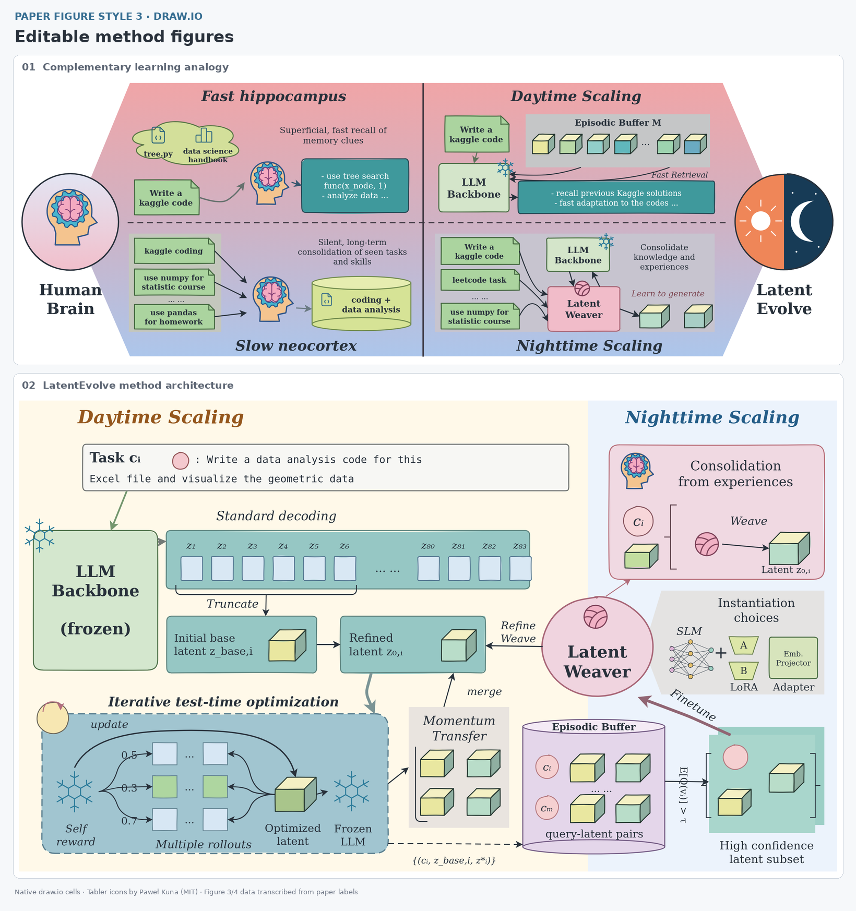
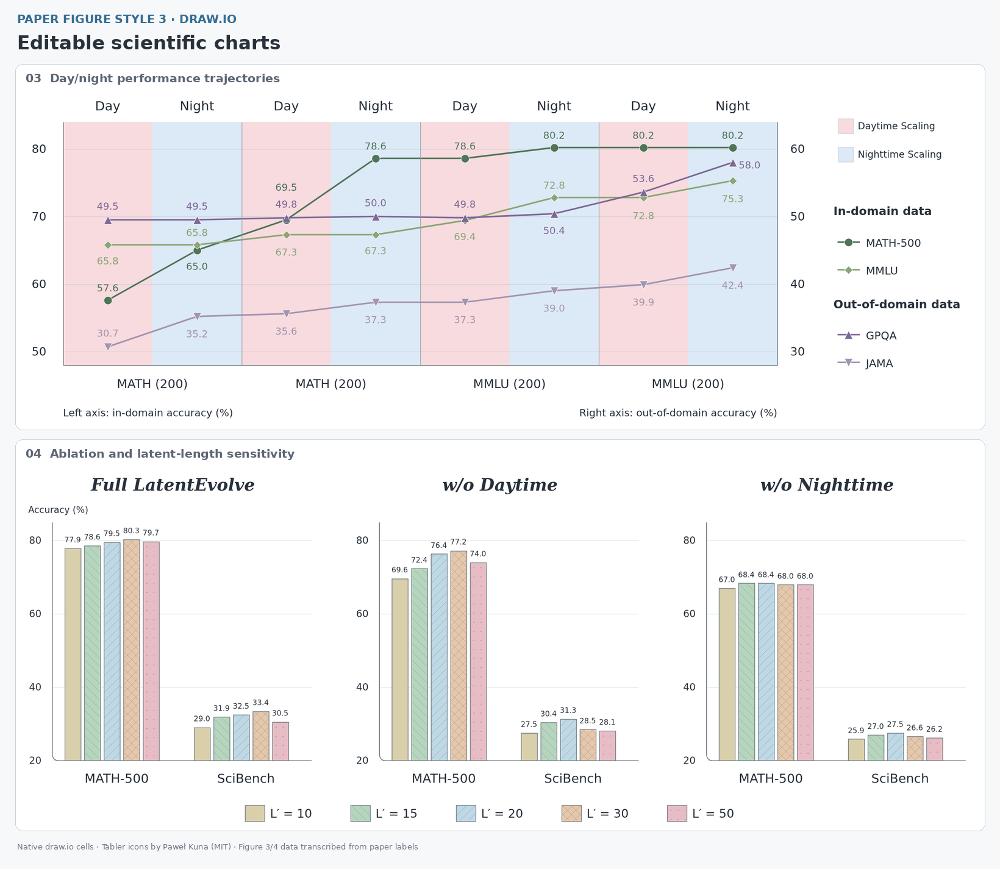

# 论文绘图风格 3：原生 draw.io

将论文原图、方法描述或绘图草稿重建为 **原生 `.drawio` 文件**。交付文字、模块、连接线、分组和可编辑 XML 图标；以 [LatentEvolve（arXiv:2509.24771v1）](https://arxiv.org/abs/2509.24771v1) 的四张图示范。核心是可复用的 draw.io 生成代码和工作方法，不依赖论文截图绘制成品。

- **直接编辑**：打开 [四页 `.drawio` 集合](assets/examples/all-figures.drawio)，也可分别打开 [图 1](assets/examples/figure-1.drawio)、[图 2](assets/examples/figure-2.drawio)、[图 3](assets/examples/figure-3.drawio)、[图 4](assets/examples/figure-4.drawio)。拖入 draw.io Desktop 或 [diagrams.net](https://app.diagrams.net/) 后选择对象编辑。
- **代码复用**：`scripts/drawio.py` 生成原生 XML；`components.py` 提供任务文档、latent 立方体、脑、纱线球、冻结标记、昼夜徽章、buffer 和网络；`examples.py` 展示完整布局和数据图。
- **图标实践**：图 1/2 的脑、雪花、代码、图表和纱线图标来自实测可获取的 Yesicon/Tabler 路线，SVG 已转成 draw.io 原生 stencil。原始 SVG、转换结果、来源、许可和 SHA256 随包保存；另有实测 Flaticon PNG 的本地获取案例。
- **真实预览**：以下预览由 draw.io 编辑器实际加载并导出。四张主图中没有图片单元；图标同样是原生 XML 形状。原图仅供参照，不进入最终文件。

## 效果预览

[](assets/previews/01_method_figures.png)

[](assets/previews/02_data_figures.png)

## 核心流程

1. **拆图**：先写一句科学信息、实体表、准确标签、分区与有向关系表。核对每项输入、分支、汇合、反馈、冻结/训练状态；再决定位置。
2. **定参照**：有论文图时直接对照原图及正文；只有文字时先画布局草案。若使用图像生成探索构图，其图片只作为视觉参照，最终仍重建原生对象。
3. **原生重建**：文字写入 `mxCell.value`；模块、图标和箭头分别建单元，重复结构分组；主要连线填写 `source`/`target`，为反馈线预留通道。
4. **逐区复核**：按区域检查对象、箭头、字号、基线、留白和遮挡；在最终论文放置尺寸下查看文字。不要把“XML 可解析”当作图已经画好。
5. **渲染交付**：在 draw.io 中实际打开并导出，检查导出后的图；交付 `.drawio`、预览、必要的 PDF/SVG、生成代码和图标许可。

## 快速使用

只编辑现成图无需安装绘图依赖。需要重新生成和自动导出时，在本 skill 目录运行：

```bash
# 原生 XML 生成和结构验证只需要 Python 3.10+
python3 scripts/build_examples.py
python3 scripts/validate_drawio.py outputs/figure-*.drawio

# 自动调用真实 draw.io 编辑器导出，需要 Node.js 20+ 与网络
npm ci
npx playwright install chromium --only-shell
node scripts/export_drawio.cjs outputs/figure-1.drawio outputs/figure-2.drawio outputs/figure-3.drawio outputs/figure-4.drawio
python3 scripts/validate_drawio.py outputs/figure-*.drawio --roundtrip-dir outputs
```

- `outputs/` 保存 `.drawio` 集合、带源 XML 的 SVG/PNG、PDF、draw.io 结构 JSON 和渲染版号记录；本地生成物不随 skill 分发。
- `export_drawio.cjs` 使用 `embed.diagrams.net` 的官方消息协议，在线编辑器会收到图的 XML。本地资料可使用 draw.io Desktop 导出，见 [安装、渲染与验收](references/03_setup_render_validation.md)。
- 可选检查/预览依赖：`python3 -m venv .venv`，然后 `.venv/bin/python -m pip install -r scripts/requirements.txt`。运行 `.venv/bin/python scripts/verify_exports.py` 和 `.venv/bin/python scripts/build_previews.py`。
- 图标重新获取与 SVG 转换：`.venv/bin/python scripts/fetch_icons.py`；完整的双来源获取案例见 [经过实测的图标来源](references/04_tested_icon_sources.md)。正常画图使用随包快照，不重复联网下载。

## 复用边界

- 用 `drawio.py` 和 `components.py` 组合自己的图；改统计数据时编辑 `assets/data/latent-evolve.json` 的副本，再用 `build_examples.py --data [DATA.json]`。完整代码示例见 [原生组件接口](references/02_drawio_components.md)。
- 原生图标可单独移动、缩放、改色，轮廓可用 draw.io 的 **Edit Shape** 编辑 XML；文字和连接线是独立对象。PNG 图标只能作为独立图片单元编辑位置、大小，其内部像素不具有路径编辑能力。
- 图 3/4 数字是从论文图面标签转录的示例，不是原始实验记录。图 3 保留双轴；图 4 对照原图使用 20% 起始的显示区间，真实数值保留在 JSON 中。新论文必须替换为自己的数据和适合的轴范围。
- 四张示例是独立重建，图标和局部排版经过统一，不声称逐像素复刻或完成实验复现。

## 文件导航

| 序号 | 文件内容概览 | 关键词 | 触发时机 | 文件路径 |
| --- | --- | --- | --- | --- |
| 01 | 给出 figure brief、实体与有向边清单、原图分区重建和逐项验收流程；说明从参考 skill 融合的可编辑优先、视觉参照、连接线与交付规则，以及四张示例的来源。 | figure brief, dependency graph, source, target, feedback, layout, LatentEvolve, draw.io, editable, image_gen | 从论文正文或原图开始画图前必须读取；选择分区和反馈路线前必须读取；对照原图检查科学关系或说明复现范围前必须读取 | [references/01_figure_workflow.md](references/01_figure_workflow.md) |
| 02 | 说明 `Diagram` 的原生形状、文字、连接线、分组和 stencil API；给出可运行的新方法图骨架、SVG 图标调用及 Figure 3/4 数据替换接口。 | drawio.py, components.py, examples.py, mxCell, mxGeometry, stencil, group, source, target, trajectories, ablation, JSON | 画新架构图或修改组件前必须读取；更改连线端点、分组和图标大小前必须读取；替换曲线/柱图数据或调整坐标轴前必须读取 | [references/02_drawio_components.md](references/02_drawio_components.md) |
| 03 | 给出 Python/Node/Playwright 安装、draw.io 在线编辑器与 Desktop 导出命令；说明 XML/原生对象/渲染回读/PDF/SVG 验证、预览重建及网络失败处理，记录实测版号和上游锚点。 | npm ci, Playwright, Chromium, export_drawio.cjs, drawio -x, validate_drawio.py, verify_exports.py, PDF, SVG, xmlpng, xmlsvg, timeout | 安装或运行导出器前必须读取；对外发布预览或交付 draw.io/PDF 前必须读取；排查空白预览、缺字体、超时和图标加载错误时必须读取 | [references/03_setup_render_validation.md](references/03_setup_render_validation.md) |
| 04 | 仅记录实际走通的 Yesicon/Tabler SVG→原生 stencil 和 Flaticon 512px PNG 获取路线；包含图标详情、许可、来源清单、转换限制、可运行双来源案例及图片 data URI 的已验证写法。 | Yesicon, Iconify, Tabler, MIT, Flaticon, Pop Vectors, SVG, PNG, fetch_icons.py, probe_icon_sources.py, sources.json, data URI | 为论文图挑选或下载第三方图标前必须读取；新增图标源、修改许可或重新分发素材前必须读取；将 SVG 转成原生 stencil 或排查破图时必须读取 | [references/04_tested_icon_sources.md](references/04_tested_icon_sources.md) |
